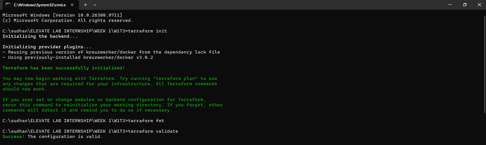
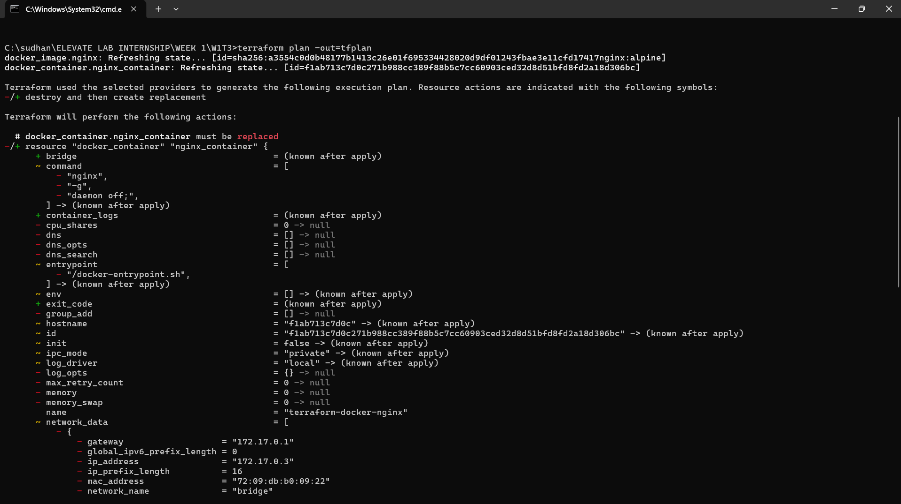
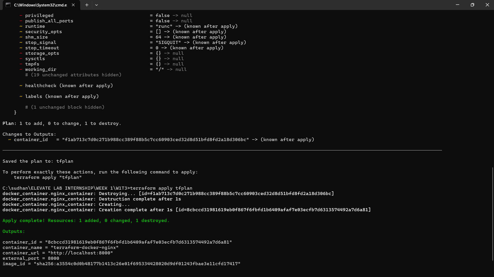
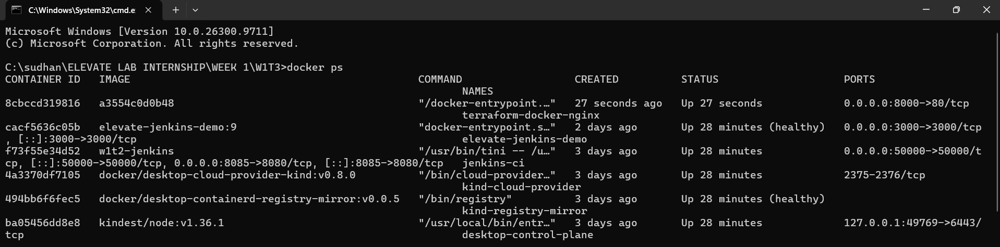
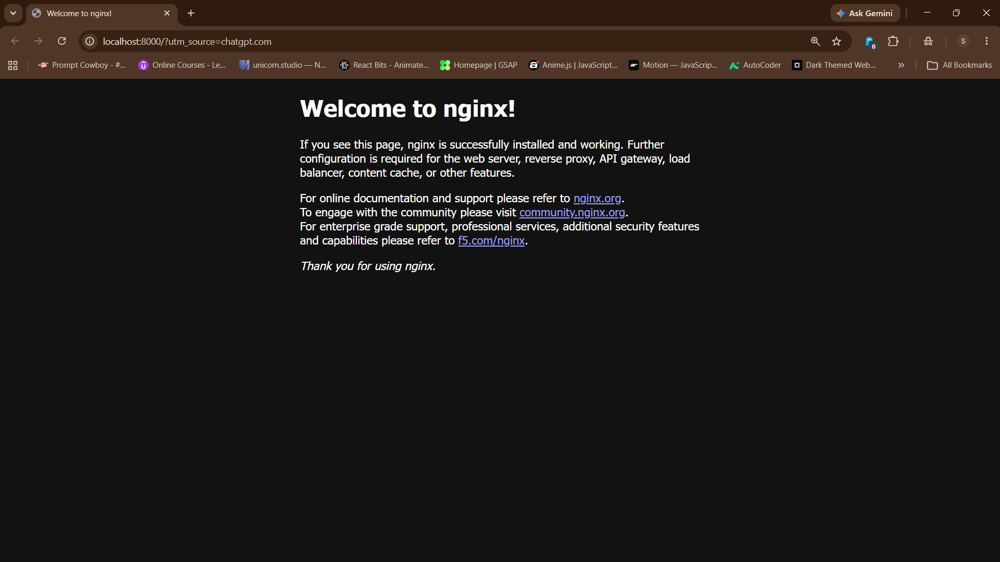
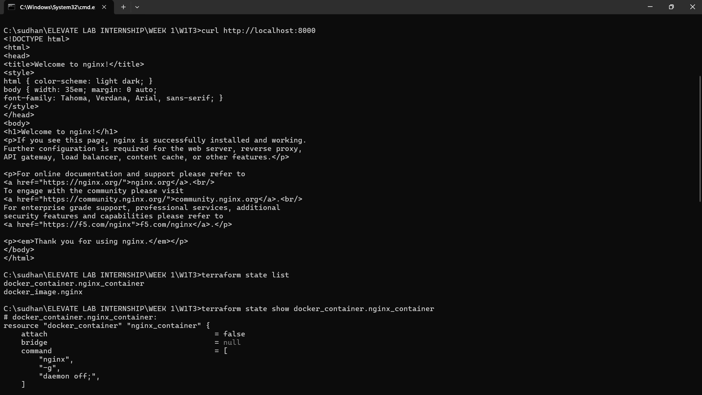
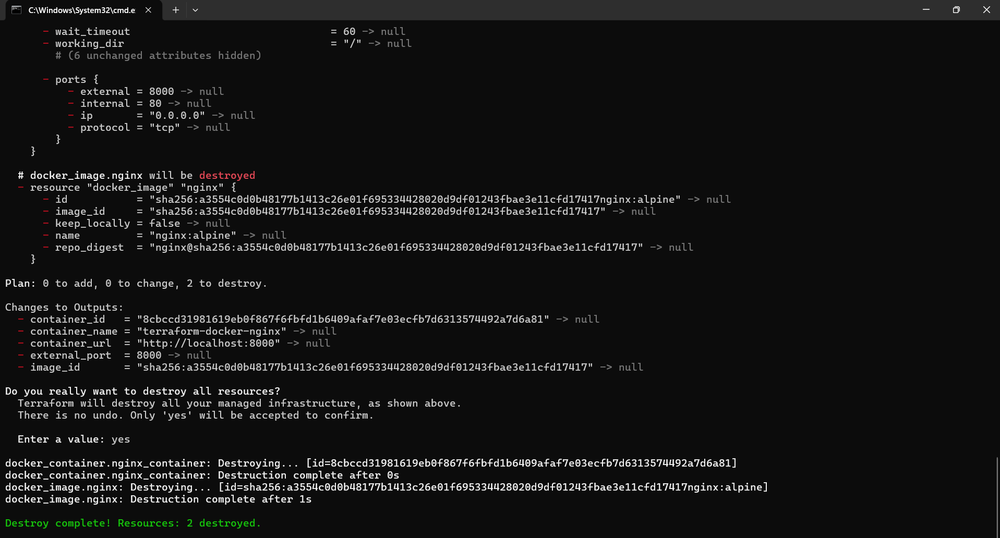

# Infrastructure as Code (IaC) with Terraform: Provisioning Docker Containers

[](https://www.terraform.io/)
[](https://www.docker.com/)
[](https://github.com/SUDARSHNACHAND/terraform-docker-iac)

> **Repository URL:** [https://github.com/SUDARSHNACHAND/terraform-docker-iac](https://github.com/SUDARSHNACHAND/terraform-docker-iac)  
> **Internship Module:** Elevate Lab Internship &mdash; Week 1, Task 3 (W1T3)  
> **Tools Used:** Terraform v1.16+, Docker Engine / Docker Desktop, Terraform Docker Provider (`kreuzwerker/docker`)  

---

## 📌 Project Objective

The goal of this project is to implement **Infrastructure as Code (IaC)** principles by automating the complete provisioning and teardown lifecycle of a local Docker container using HashiCorp Terraform.

Instead of relying on manual, imperative terminal commands (`docker run`, `docker rm`), all infrastructure specifications (image source, container properties, port mappings, and runtime constraints) are declared in declarative HashiCorp Configuration Language (`.tf`).

---

## 🏗️ Architecture & IaC Workflow

```
+-------------------------------------------------------------+
|                     Terraform Codebase                      |
|   (main.tf, variables.tf, outputs.tf, terraform.tfstate)    |
+-------------------------------------------------------------+
                              │
                    Terraform CLI Engine
           (init -> plan -> apply -> state -> destroy)
                              │
                              ▼
            +────────────────────────────────────+
            | kreuzwerker/docker Provider v3.0.2 |
            +────────────────────────────────────+
                              │
                   Docker Engine Named Pipe
        (npipe:////./pipe/dockerDesktopLinuxEngine)
                              │
                              ▼
                +───────────────────────────+
                |    Local Docker Daemon    |
                +───────────────────────────+
                 /                         \
                ▼                           ▼
        +───────────────+           +────────────────────────+
        | Docker Image  |           |    Docker Container    |
        |  nginx:alpine |           | terraform-docker-nginx |
        +───────────────+           |   (0.0.0.0:8000->80)   |
                                    +────────────────────────+
```

---

## 📁 Repository Structure

```plaintext
terraform-docker-iac/
├── .gitignore                      # Excludes .terraform cache and tfstate files
├── .terraform.lock.hcl             # Locks exact provider plugin version
├── main.tf                         # Core resource declarations (provider, image, container)
├── variables.tf                    # Parameterized variables (pipe, image, ports)
├── outputs.tf                      # Exported attributes (container ID, name, URL)
├── terraform.tfvars.example        # Example variable values for overrides
├── execution_logs.txt              # Complete terminal transcript of all steps
├── README.md                       # Comprehensive guide with embedded screenshots
└── screenshots/                    # Ordered visual proof of workflow execution
    ├── 01_terraform_init_fmt_validate.png
    ├── 02_terraform_plan.png
    ├── 03_terraform_apply.png
    ├── 04_docker_ps_verification.png
    ├── 05_browser_nginx_running.png
    ├── 06_curl_and_terraform_state.png
    └── 07_terraform_destroy.png
```

---

## 📜 Terraform Code Details

### 1. `main.tf`
Configures the Terraform Docker provider, pulls the lightweight `nginx:alpine` image, and provisions the container with port forwarding:

```hcl
terraform {
  required_version = ">= 1.0.0"
  required_providers {
    docker = {
      source  = "kreuzwerker/docker"
      version = "~> 3.0.2"
    }
  }
}

# Configure the Docker Provider
provider "docker" {
  host = var.docker_host
}

# Pull the Docker image
resource "docker_image" "nginx" {
  name         = var.image_name
  keep_locally = false
}

# Provision the Docker container
resource "docker_container" "nginx_container" {
  name  = var.container_name
  image = docker_image.nginx.image_id

  ports {
    internal = var.internal_port
    external = var.external_port
    ip       = "0.0.0.0"
  }
}
```

### 2. `variables.tf`
Parameters for flexibility and clean reusability:
- `docker_host`: Default `npipe:////./pipe/dockerDesktopLinuxEngine` (Windows Docker Desktop endpoint).
- `container_name`: Default `terraform-docker-nginx`.
- `internal_port`: Default `80`.
- `external_port`: Default `8000`.

### 3. `outputs.tf`
Exports the provisioned resource details:
- `container_id`: Unique container hash.
- `container_name`: Assigned container name.
- `container_url`: `http://localhost:8000`.

---

## 📸 Ordered Screenshot Flow Display

Below is the verified, sequential order flow showing each stage of the Infrastructure as Code lifecycle:

### Step 1: Initialize, Format & Validate Configuration
Downloads the `kreuzwerker/docker` provider, checks canonical formatting, and validates configuration syntax.
```bash
terraform init
terraform fmt
terraform validate
```


---

### Step 2: Generate Execution Plan (`terraform plan`)
Previews the proposed changes before making any modifications to real infrastructure.
```bash
terraform plan -out=tfplan
```


---

### Step 3: Apply Infrastructure (`terraform apply`)
Applies the plan to create the Docker image and container.
```bash
terraform apply "tfplan"
```


---

### Step 4: Verify Running Container (`docker ps`)
Confirms that the Docker container `terraform-docker-nginx` is active and mapped to host port `8000`.
```bash
docker ps
```


---

### Step 5: Test Web Server via Browser
Navigating to `http://localhost:8000` renders the live Nginx default landing page:


---

### Step 6: Test HTTP Endpoint & Inspect State (`terraform state`)
Verifies HTTP response via `curl` and inspects the Terraform state file (`state list` and `state show`).
```bash
curl http://localhost:8000
terraform state list
terraform state show docker_container.nginx_container
```


---

### Step 7: Clean Teardown (`terraform destroy`)
Destroys all provisioned resources cleanly with a single command.
```bash
terraform destroy
```


---

## 💡 Key Learnings & Outcomes

| Concept | Imperative Docker CLI | Declarative IaC with Terraform |
| :--- | :--- | :--- |
| **Reproducibility** | Fragile, prone to missed flags | 100% reproducible via version-controlled code |
| **State Tracking** | No record of intent vs reality | `terraform.tfstate` tracks complete resource lifecycle |
| **Pre-execution Safety**| Run and hope for the best | `terraform plan` previews changes beforehand |
| **Teardown Automation** | Manual `docker stop` & `docker rm` | Single command `terraform destroy` with zero leftover resources |
| **Portability** | Shell-specific commands | Provider-driven abstraction across Windows/macOS/Linux |

---

## 👨‍💻 Author
- **GitHub:** [@SUDARSHNACHAND](https://github.com/SUDARSHNACHAND)  
- **Repository:** [terraform-docker-iac](https://github.com/SUDARSHNACHAND/terraform-docker-iac)
